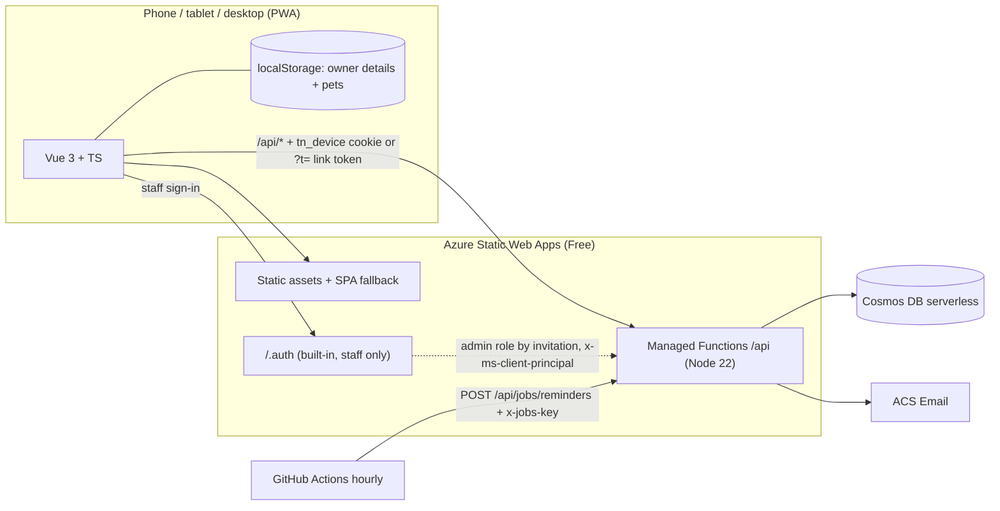

# Top Notch Dog Grooming — online booking

Pet owners book grooming appointments from a calendar that shows how busy each day is, with no account or password: their contact details and pets are saved on their own phone and sent with each booking. The groomer runs the day from a phone or tablet: check-in, start, done, report cards, time off, prices and reports.

**Stack:** Vue 3 + TypeScript (Vite, Pinia, Vue Router) · Azure Static Web Apps (**Free**) with managed **Node.js 22 Azure Functions** in `/api` · **Azure Cosmos DB** (NoSQL, serverless) · Azure Communication Services email · Bicep · GitHub Actions. Staff sign in with the Static Web App's built-in Microsoft or GitHub login.

Settled scope: one groomer, no online payments, no owner accounts, email notifications, and phone-first UI everywhere.

**Brand:** the Top Notch logo (`public/brand/logo.png` and `logo@2x.png`) and its palette run through the whole app: logo yellow `#FAD006`, black and white. Swap in a higher-resolution logo by replacing those two files, keeping the names, and the header, home page, emails and app icons all pick it up. The icons are regenerated from it.

**Services and prices (Philippine pesos):** the shop's price list is built in and shown as a services menu on the home page and at `/services`. Dog prices go by the **dog size** owners pick when they add a dog; cats are one price. Ranges depend on coat volume, and the groomer enters the final amount at check-out.

| Service | Small | Medium | Large (e.g. Golden Retriever) | Husky, Chow Chow & similar |
|---|---|---|---|---|
| Basic Grooming | ₱380 shaved / summer cut, ₱430 with face design | ₱480, ₱530 with face design | ₱650 | ₱750–₱850 |
| Full Grooming | ₱500 | ₱600 | ₱700 | ₱800–₱850 |
| Cat Grooming | ₱500 for every cat | | | |
| Bath / Blow Dry | ₱250 | ₱350 | ₱450–₱550 | ₱450–₱550 |

Basic Grooming includes bath and blow dry, nail cut, ear cleaning, sanitary cleaning, paw pad trimming, toothbrush and anal drain; Full Grooming adds a full haircut with design; Cat Grooming covers bath and blow dry, nail cut, ear cleaning, sanitary cleaning and paw pad trimming. The face design is an option on Basic Grooming for small and medium dogs. Times are starting values. Change any of it under Shop settings → Services and Extras. The shop time zone defaults to `Asia/Manila`.

---

## Features

### For pet owners
- **No account.** The first booking asks for contact details and the pet, saves them on that phone or computer, and every later booking takes a couple of taps. Bookings made from a device show up under Visits on that device; the link in every email opens the booking on any device.
- **Tile calendar of open times.** Each day is a tile whose yellow fill rises as it books up. It shows the count of open starts, swipes between months, has full keyboard and screen-reader support, and a **Next opening** button.
- **4-step booking** (pet, service, time, confirm) with each service's inclusions, price and duration for the pet's size (and the face-design option where it applies), pick-up time, notes for the groomer, and a sticky thumb-zone action bar.
- **Repeat visits:** book every N weeks for several visits in one go. Dates that are taken are skipped and listed.
- **Waitlist** for full days, by any time, morning or afternoon. When someone cancels, everyone waiting gets an email straight away.
- **Change time or cancel** without calling. Late changes inside the policy window are flagged, not blocked.
- **Pet profiles** (saved on the device; each booking sends a copy to the groomer, without the photo): camera photo (resized on the phone), breed, a required **Dog size** dropdown (cats have no size), weight in kg, temperament, behaviour notes and grooming preferences.
- **Dashboard:** next visit with countdown, **Add to calendar** (`.ics` served as `text/calendar` so iOS and Android open it natively), Google Calendar link, directions, share sheet, one-tap **Book again**, and the groomer's suggested next date.
- **Report cards and reviews** after each visit (1–5 stars plus comment).
- **Emails:** confirmation with calendar attachment, change, cancellation (with `METHOD:CANCEL` .ics), 24-hour reminder (opt-out), waitlist opening, and report card ready.
- **Client details:** full name, contact number, email and address are collected before the first booking and editable under Me, along with reminder preferences and emergency contact. **Download my data** (JSON, built in the browser) and **Forget me on this device** (clears the saved details, pets and device key; bookings stay with the shop).
- **Installable PWA:** home-screen icon, works offline for viewing saved visits, offers a one-tap update, follows dark mode, respects reduced motion.

### For the groomer (staff portal, `admin` role)
- **Today:** agenda with pet alerts (nervous, reactive or senior, plus behaviour notes), owner notes, tap-to-call, one-tap **Check in → Start groom → Mark done**, no-show, free gaps for walk-ins, auto-refresh, swipe between days.
- **Week board:** time grid with breaks, closures and status colours. On phones it starts at today.
- **Appointment detail:** amount actually charged, private staff notes, report card (emails the owner), move, cancel with a reason (emails the owner), and "text ready for pick-up".
- **Clients:** built from bookings and grouped by contact number (`0917 123 4567` and `+63 917 123 4567` are one client). Search by owner, phone or pet name; contact number, email and address as given on the latest booking; pet profiles; history; lifetime spend; no-show count and **Excuse**; **Book for client** for phone bookings from a client's history, which bypasses notice and horizon rules but never overlaps and shows up on the client's own phone.
- **Shop settings:** services (what's included, plus duration, price, optional "up to" price and a note for each dog size), extras that can be tied to one service and certain sizes (the face design to start), weekly hours with breaks, booking rules (start-time step, clean-up buffer, minimum notice, horizon, cancellation window, daily cap, per-client cap, no-show pause), shop details, policy text, and time off (full or partial days).
- **Reports:** revenue, average ticket, no-show rate, late cancellations, new clients, rating, visits by weekday and hour, top services, and **CSV export** (formula-injection safe).

---

## Architecture



- **Owners (no sign-in):** the owner's details and pets live in the browser's localStorage (`src/stores/account.ts`) and go with every booking, which stores a copy for the groomer. The first booking from a device makes the API set `tn_device`, a random key in an HttpOnly, Secure, SameSite=Lax cookie scoped to `/api` that page scripts can't read. Appointments store only its SHA-256 hash (`ownerId`), which lists and manages that device's bookings. Every email carries a per-appointment `manageToken` link (`/appointments/{id}?t=…`) that works on any device. See `api/src/lib/device.ts`.
- **Staff:** the Static Web App's built-in Microsoft (`/.auth/login/aad`) or GitHub login, with the `admin` role granted by invitation (portal: Static Web App → Role management, up to 25 people on the Free plan). The route rule in `staticwebapp.config.json` gates `/api/staff/*`, and every staff handler re-checks the role.
- **Reminders:** managed functions only support HTTP triggers, so `.github/workflows/reminders.yml` calls a key-protected endpoint hourly. It's idempotent because each appointment is stamped `reminderSentAt`.

### Why double booking can't happen

The day is cut into 15-minute blocks. Every appointment owns one **lock document** per block it covers (service time plus clean-up buffer, e.g. `lock-09:15`). The `bookings` container is partitioned by **day**, so the appointment, its locks and a per-day counter are written in **one Cosmos transactional batch**. If any lock already exists, Cosmos returns `409` and the whole batch rolls back. Two people tapping the same time at the same moment get one booking and one "someone just booked that time".

- The per-day counter uses an ETag (`If-Match`) to enforce the daily cap atomically.
- Cancel and reschedule release locks in the same transaction, with ETag checks against stale edits.
- Locks always use the 15-minute grid, even if you change start times to every 30 or 60 minutes, so they never misalign.
- Lock, summary and waitlist documents carry a Cosmos **TTL** and expire about a week after their day. Appointments are kept.

`api/test/booking.test.ts` races two overlapping bookings against an in-memory container with the same batch semantics. `api/test/availability.test.ts` covers hours, breaks, closures, buffers, notice, horizon, daily caps and a DST change.

### Data model (database `grooming`)

| Container | Partition key | Holds |
|---|---|---|
| `bookings` | `/day` | appointments (each with a copy of the owner's details and pet profile), slot locks, a daily `summary`, waitlist entries |
| `catalog` | `/kind` | `settings`, services, add-ons, closures |

There are no owner or pet records on the server. The staff Clients screen groups appointments by `clientKey` (the contact number as digits) and shows the newest details.

Settings and the service menu are seeded on first run. A database seeded before the peso price list gets it once on the next cold start: untouched original services are replaced, edited ones keep their prices and just gain their "what's included" list.

---

## Project layout

```
├─ src/                      Vue app
│  ├─ components/            TileCalendar, SlotPicker, PetForm, AgendaCard, BarChart, SheetDialog…
│  ├─ views/                 owner screens; views/admin/ = staff portal
│  ├─ stores/                Pinia: session (staff), account (this device's owner), catalog, ui
│  ├─ composables/           useAvailability (cached + prefetch), useSwipe, useStaffActions
│  └─ api/client.ts          typed API client
├─ api/                      Azure Functions (v4 programming model, TypeScript)
│  ├─ src/functions/         public, appointments, waitlist, admin (staff), jobs
│  ├─ src/lib/               availability engine, transactional booking, Cosmos, email, device key, staff auth, validation (zod)
│  ├─ src/shared/            types + helpers shared with the front end (single source of truth)
│  └─ test/                  vitest
├─ infra/main.bicep          SWA (Free), Cosmos, ACS Email (+ main.bicepparam)
├─ tools/demo-server.mjs     click-through demo with an in-memory API (no Azure needed)
├─ staticwebapp.config.json  routes, staff role, CSP and security headers
├─ .github/workflows/        CI/CD with PR preview environments, hourly reminders
├─ .vscode/extensions.json   recommended VS Code extensions (incl. Claude Code)
├─ CLAUDE.md                 project briefing Claude Code reads at the start of every session
└─ .claude/settings.json     Claude Code guardrails: no reading secrets, ask before az / git push
```

---

## Try it in two minutes (no Azure)

```bash
npm install && npm --prefix api install
npm run build && npm --prefix api run build
npm run demo
```

Open `http://localhost:4280/?as=owner` for a returning customer (details and pets saved in the browser), `?as=guest` for a first visit, or `?as=admin` for the staff portal. The demo uses the real availability engine with sample data held in memory.

## Run the full stack locally

Prerequisites: Node 22, [Azure Functions Core Tools v4](https://learn.microsoft.com/azure/azure-functions/functions-run-local), [SWA CLI](https://azure.github.io/static-web-apps-cli/) (`npm i -g @azure/static-web-apps-cli`), and the [Cosmos DB emulator](https://learn.microsoft.com/azure/cosmos-db/emulator) (or a real serverless account).

```bash
cp api/local.settings.sample.json api/local.settings.json
npm --prefix api start      # Functions on :7071 (builds first)
npm run dev                 # Vite on :5173
swa start                   # everything on http://localhost:4280 via swa-cli.config.json
```

Owners need no sign-in. For the staff portal, open `/staff`; the SWA CLI shows a mock sign-in form, so type `admin` in the roles box. Leave `ACS_CONNECTION_STRING` empty locally and emails are logged instead of sent.

---

## Deploy to Azure

### 1. Provision infrastructure

```bash
az login
az group create -n rg-topnotch -l centralus
export JOBS_KEY="$(openssl rand -hex 24)"     # keep this; GitHub needs it too
az deployment group create -g rg-topnotch -f infra/main.bicep -p infra/main.bicepparam
```

Outputs include the site name and hostname.

### 2. Configure GitHub and deploy

| Kind | Name | Value |
|---|---|---|
| Secret | `AZURE_STATIC_WEB_APPS_API_TOKEN` | `az staticwebapp secrets list -n <swa-name> --query properties.apiKey -o tsv` |
| Secret | `JOBS_KEY` | same value as in step 1 |
| Variable | `SWA_HOSTNAME` | e.g. `nice-sea-0123.azurestaticapps.net` or your custom domain |

Push to `main`. The workflow type-checks both projects, runs the booking-engine tests, builds and deploys. Pull requests get their own preview URL (up to 3 at a time on the Free plan).

### 3. Invite the staff

Owners never sign in. For each groomer or staff member: Azure portal → your Static Web App → **Role management → Invite**. Choose **Microsoft Entra ID** (any Microsoft account, e.g. Outlook or Hotmail) or **GitHub**, enter their email or GitHub username, and type `admin` as the role. Send them the invitation link; once they've opened it, they sign in at `https://<your-site>/staff` and land in the staff portal. The Free plan allows up to 25 invited people. To remove someone, delete them from the same list.

### 4. Optional polish
- **Custom domain:** add it in SWA and update `APP_BASE_URL`.
- **Custom email domain:** connect a verified domain to the ACS Email service for your own sender address and better deliverability.
- **Staff copy of bookings:** set `STAFF_NOTIFY_EMAIL`.

---

## Configuration (SWA application settings)

| Setting | Purpose |
|---|---|
| `COSMOS_ENDPOINT` / `COSMOS_KEY` (or `COSMOS_CONNECTION_STRING`) | Cosmos DB access. Managed functions can't use managed identity. |
| `COSMOS_DATABASE` | default `grooming` |
| `COSMOS_SKIP_INIT` | `true` skips create-if-not-exists and seeding on cold start |
| `ACS_CONNECTION_STRING` / `EMAIL_SENDER` | email. Leave empty to log instead of send. |
| `STAFF_NOTIFY_EMAIL` | optional copy of online bookings, moves and cancellations |
| `JOBS_KEY` | secret for `/api/jobs/reminders` (24+ chars) |
| `REMINDER_LEAD_HOURS` | default `24` |
| `APP_BASE_URL` | absolute links in emails |
| `SHOP_TIME_ZONE` | time zone used when seeding settings (default `Asia/Manila`) |

Everything else (hours, rules, prices, policies) is edited in the staff portal. Who counts as staff is managed under Role management in the portal, not in settings.

## API reference

| Method & route | Who | What |
|---|---|---|
| `GET /api/public/catalog` | anyone | shop settings, services, extras, upcoming closures, rating |
| `GET /api/public/availability?from&to&serviceId&size&addOns[&exclude][&t][&staff=1]` | anyone* | per-day status, open starts, capacity, next opening |
| `GET /api/appointments` | device | this device's bookings (none without a `tn_device` cookie) |
| `POST /api/appointments` | anyone | book with the owner's details and pet in the body (incl. repeat series); sets or renews `tn_device` |
| `GET /api/appointments/{id}` · `/ics` | device, `?t=` link or staff | details, calendar file |
| `POST /api/appointments/{id}/cancel` · `/reschedule` · `/review`, `PUT …/notes` | device or `?t=` link | manage a booking |
| `POST /api/device/forget` | anyone | clear the `tn_device` cookie |
| `GET/POST /api/waitlist`, `DELETE /api/waitlist/{day}/{id}` | device | waitlist |
| `GET /api/staff/agenda?from&to` | staff | appointments, waitlist and closures for a range |
| `POST /api/staff/appointments` | staff | book for a client from their history (`ownerId` = their device) |
| `GET /api/staff/appointments/{id}`, `POST …/status` · `…/reschedule`, `PUT …/staff-notes` · `…/report-card` | staff | run the day |
| `GET/PUT /api/staff/settings` | staff | hours and rules |
| `GET/POST /api/staff/catalog/{service\|addon\|closure}`, `PUT/DELETE …/{id}` | staff | menu and time off |
| `GET /api/staff/clients?q`, `GET /api/staff/clients/{clientKey}`, `POST …/excuse-no-shows` | staff | client lookup, excuse no-shows |
| `GET /api/staff/stats?from&to`, `GET /api/staff/export?from&to` | staff | reports, CSV |
| `POST /api/jobs/reminders` | GitHub Actions (`x-jobs-key`) | send due reminders |
| `GET /api/health` | anyone | liveness + Cosmos check |

\* `exclude` requires the booking's device, its `t` link token, or staff; `staff=1` requires staff.

## Security notes
- **Owners:** a booking can be read or changed only from the device that made it (HttpOnly `tn_device` cookie; the server keeps just its hash) or with that booking's email-link token, compared in constant time. Treat the links in confirmation emails like a key: anyone with the email can manage that booking. `Referrer-Policy` keeps the token out of links to other sites.
- **Staff:** two layers, the SWA route rule on `/api/staff/*` and `requireAdmin` in every staff handler.
- **No sign-up means no identity check:** anyone can book under any name, email or phone. The daily cap, the per-client cap and the no-show pause (both matched on contact number and device) limit abuse, and staff can cancel fake bookings.
- All input is validated with zod. Pet photos never leave the device. Times must sit on the 15-minute grid.
- Strict CSP, HSTS, `nosniff`, and `frame-ancestors 'none'`. No third-party scripts or fonts; the Recursive font is self-hosted.
- "Forget me on this device" clears the saved details, pets, device cookie and cached API responses; staff sign-out clears cached responses too, so shared tablets are safe.
- The CSV export neutralises spreadsheet formulas. The jobs endpoint uses a constant-time key compare.

## Design decisions worth knowing
- **No owner accounts, to keep the Free plan.** Custom sign-in (Entra External ID) needs the Standard plan; dropping it and keeping staff on the built-in login lets the site run on Free. The trade-offs: an owner's saved details are per device; Safari may clear a site's saved data after about a week without a visit unless it's added to the home screen (the Me screen suggests it); and the client list is only as accurate as the details people type.
- **Reminders through GitHub Actions** keep everything inside managed functions. GitHub may delay scheduled runs, and in **public** repositories it pauses them after 60 days without activity. Alternatives: a Logic App recurrence calling the same endpoint, or "bring your own" Functions with a timer trigger, which also enables managed identity for Cosmos.
- **Key auth to Cosmos** is required by managed functions. The key lives only in SWA app settings, written by Bicep with `listKeys()`.
- **Cross-day reschedules** book the new day first and then release the old one, so a failure can never leave the owner with no booking. Reads prefer the newest copy.

## Ideas for later
Online deposits (Stripe), SMS through ACS, multiple groomers or tables (add a `resourceId` to locks), loyalty punch card, before-and-after photo gallery (Blob Storage), syncing the groomer's agenda to Outlook or Teams, and a seasonal promotions banner.
